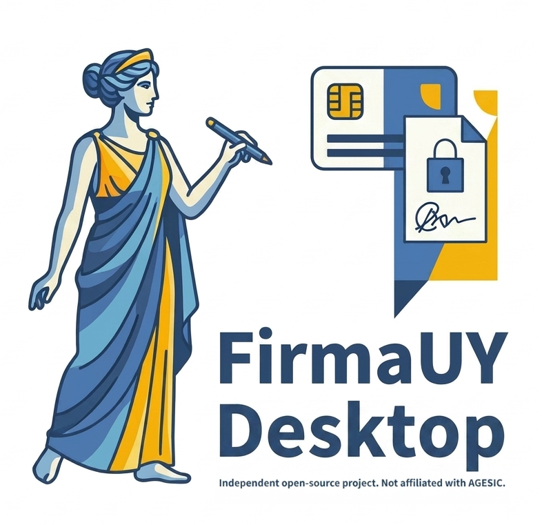
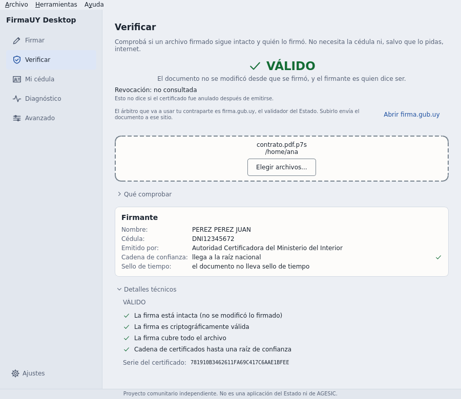
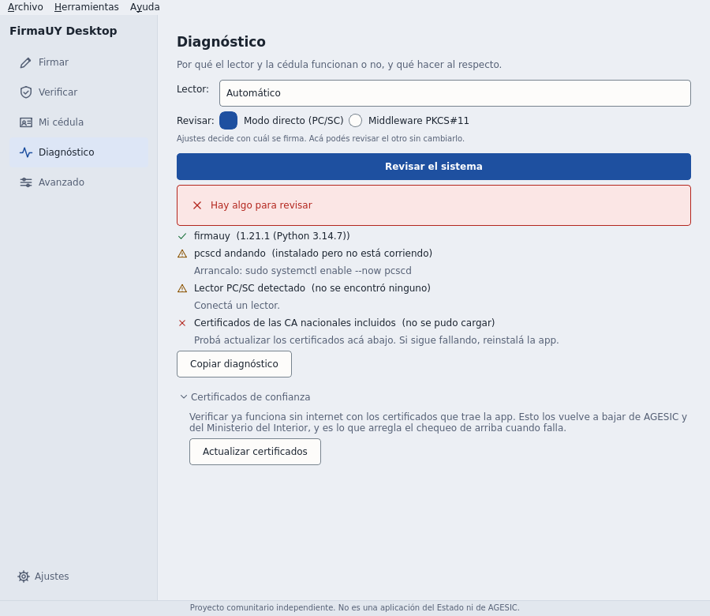
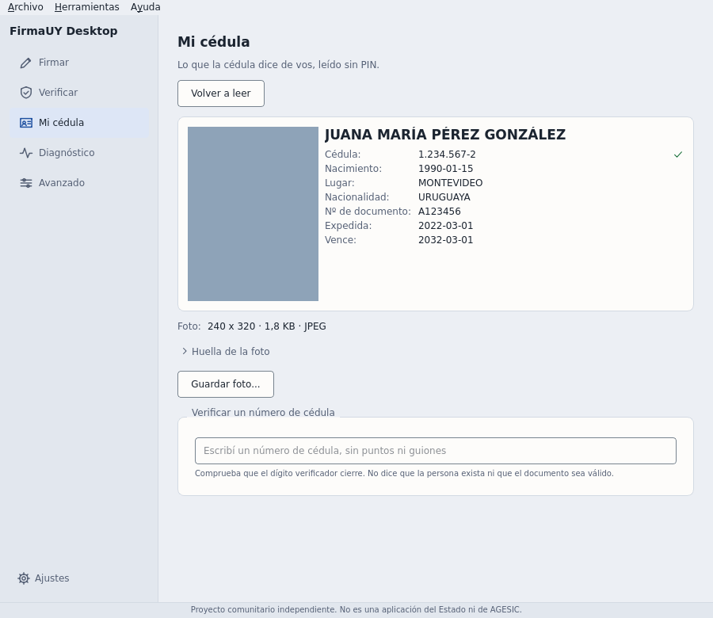
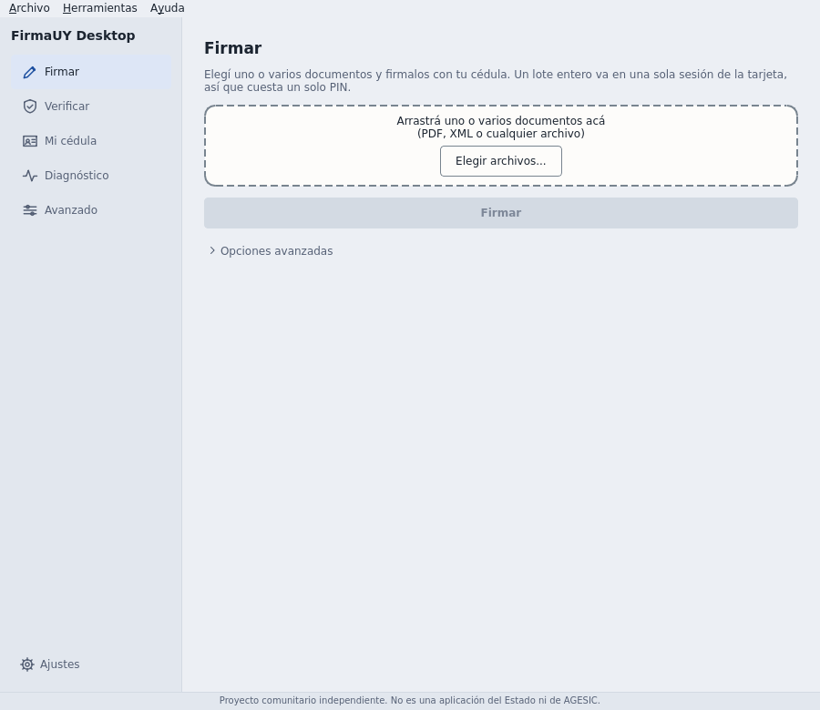

# FirmaUY Desktop

<p align="center">
  
</p>

**Your cédula is a signing key. This is the window for it.**

Drag a document in and sign it. Drop a signed one in and get an answer in plain Spanish, with
every check that produced it. Both work offline: signing and verifying are local by default, and
what does use the network is listed under Privacy. The signing and the
verifying are [firmauy](https://github.com/carlosplanchon/firmauy)'s, which brings the same card
to the terminal. This repository is the part a person can use without one.

[](https://github.com/carlosplanchon/firmauy-desktop/actions/workflows/ci.yml)
[](https://github.com/carlosplanchon/firmauy-desktop)
[](https://opensource.org/licenses/Apache-2.0)
[](https://deepwiki.com/carlosplanchon/firmauy-desktop)

> **Status: alpha.** The screens work on Linux and Windows. Signing defaults to the direct
> PC/SC backend (no OpenSC or middleware needed, just a reader, and `pcscd` on Linux), and
> a PKCS#11 module can be configured instead. The Windows builds are not code-signed yet, and
> there is no macOS build.

> **Not an official application of the Uruguayan State, and not affiliated with AGESIC.** It is
> an independent tool built on the published interfaces of the cédula. What that disclaims is
> the software, not the signature: the signature is made by your own card, with the certificate
> the Ministerio del Interior put on it, and is worth exactly what that certificate is worth
> whatever program produced it.

> **Always cross-check what you sign.** Before sending or relying on a signed document, upload
> it to [firma.gub.uy](https://firma.gub.uy/), the State validator, and keep its answer. That is
> the arbiter your counterparty will use, and no tool checking its own output replaces it.
> Uploading is also the one step that leaves your machine, so weigh it for confidential files.

## What it looks like

|  |  |
| --- | --- |
|  |  |
|  |  |

Light and dark follow the system, and can be forced in Ajustes. Every value in those images is
synthetic, and the cardholder photo is a flat rectangle generated at run time: no real name,
number or face has ever been in this repository. They are rebuilt with
`uv run python -m tools.screenshots` rather than captured by hand, which is what keeps that true.

## Screens

- **Firmar**: drag one file or several and sign them. The signature matches the
  document: a PDF comes back as a signed PDF (PAdES, with a visible signature), an XML
  as a signed XML (XAdES), anything else as a detached `.p7s` (CAdES). Several files
  sign in a single card session, so the PIN is asked **once** for the whole batch, and a
  long one can be cancelled: it stops after the file it is on.
  The PIN is asked for in a dialog only after the reader and the cédula are confirmed,
  so a card that is not there never costs a PIN try, and the dialog will not take a PIN
  the cédula could not have: 4 to 8 digits, and nothing else.
- **Verificar**: drop a signed file (PDF, XAdES XML or `.p7s`), or several at once, and get a
  verdict (VÁLIDO / INDETERMINADO / INVÁLIDO) with a sentence saying what it means, who
  signed, and every individual check under "Detalles técnicos". A batch gets a row per file
  with its verdict and one honest count over the whole set, and selecting a row shows that
  file's full answer. Offline by default, and the answer comes with a pointer to
  firma.gub.uy, the cross-check recommended above. When a detached `.p7s` arrives without the
  file it signs, it asks which one that is, without holding up the rest of a batch.
- **Mi cédula**: read the card's own data over PC/SC, with no PIN: the holder's
  photo, name, cédula number (with its check digit verified), birth date and
  expiry. The photo can be saved. Also checks any cédula number's check digit,
  which needs no card at all.
- **Diagnóstico**: a visual health check of the signing environment (reader, card,
  bundled CA certificates), the reader picker, and a button to refresh the national
  CA certificates. "Copiar diagnóstico" leaves out anything that could identify you.
- **Avanzado** (off by default): what the PKCS#11 module sees on the card, and a
  way to export your public certificate as PEM. Turn it on in Ajustes. Everything on it goes
  through a PKCS#11 module, so it needs one installed, which the default direct backend does not.

Ajustes holds the choices that are about the machine rather than a document: the
backend, the reader, the PKCS#11 module and a timestamping authority.

## What you need

- **A card reader** and a **cédula whose certificate is still valid**. The certificate expires
  with the card, so a cédula past its date signs nothing and has to be renewed.
- **Linux x86_64, or Windows 10 or 11 (64-bit).** There is no macOS build yet.
- **On Linux, `pcscd` running.** That is the entire requirement for the default backend, which
  talks to the card directly over PC/SC. No OpenSC, no proprietary middleware, nothing else to
  install.
- **On Windows, nothing.** Windows ships the reader driver and the Smart Card service the default
  backend talks to, and starts the service by itself when a reader is plugged in.
- **A PKCS#11 module**, and only then: if you switch the backend in Ajustes, or use the Avanzado
  screen, which is built on one. On Linux the cédula's module is `libgclib.so`, packaged on Arch
  Linux as `cedula-uruguay-pkcs11`; the full smart-card setup is in
  [firmauy's README](https://github.com/carlosplanchon/firmauy#setup-on-arch-linux), which is
  where it is maintained rather than copied here. On Windows it is Thales Classic Client, and the
  app finds its module on its own at `C:\Program Files\Thales\Classic Client\BIN\gclib.dll`.
  Classic Client also installs a 32-bit copy under `Program Files (x86)`, which this 64-bit app
  cannot load, and Diagnóstico says so if it is the one configured.
- **Python 3.11 or newer**, only to run from source. A packaged build carries its own.

**Diagnóstico answers all of this from inside the app**, so a card that does not show up is a
screen to open rather than something to guess at: it reports firmauy's version, whether `pcscd`
(on Windows, the Smart Card service) is answering, which readers it can see, and whether the
national CA certificates are in place.

## Privacy

The app makes no network call you did not ask for. Signing and verifying are local and work with
the machine offline, and everything happens in this one process: firmauy is imported rather than
run as a subprocess, so nothing about your documents or your cédula crosses a pipe either.

Four things do reach the network, each because you asked for it, and only one of them sends the
document:

- **Uploading to firma.gub.uy** to cross-check a signature, in your browser rather than from
  the app. The step recommended above, and the only one that sends the document itself, to a
  State-operated service.
- **Timestamping**, when a TSA URL is set in Ajustes or, for one document, under Opciones
  avanzadas in Firmar. What is sent is a hash, never the document.
- **Checking whether a certificate was revoked**, when it is turned on in Verificar. Off by
  default, and it is the only part of verification that is not offline.
- **"Actualizar certificados" in Diagnóstico**, which re-downloads the national CA certificates
  from their official sources (with a fingerprint-pinned mirror as fallback). It sends nothing
  about you or your documents, and it is a button you press: verification already works offline
  against the copies inside the build.

The timestamp request and the revocation lookups go to public addresses only, unless "Permitir
servidores de la red local" is ticked in Ajustes, for a TSA or a revocation mirror inside your own
network. It is off by default, because with it on the addresses a revocation lookup follows come
from the certificates in the file being verified, which somebody else sent.

What the app keeps, and what it deliberately does not:

- **The PIN** lives in memory for the signature it was asked for. It is never written to disk, a
  log, a crash report or a window title, and never reaches a command line, an environment
  variable or a pipe.
- **The settings** hold the backend, the reader, a module path, a TSA and its certificate, which
  checks run after signing and when verifying (including whether a timestamp's origin is
  validated), whether servers on the local network are allowed, the appearance, how the stamp
  looks, the window's size and position, and the toggles for Avanzado and the activity record. No name, no document
  number, and no list of recent files, on purpose.
- **Mi cédula** reads the cardholder's data and photo from the card and puts them on screen.
  Nothing is written until you press the button that asks where to put it, and the same goes for
  exporting a certificate from Avanzado.
- **Copiar diagnóstico** hides the detail of every check firmauy flags as able to carry your own
  name, since some PKCS#11 modules use it as the token label. A check that arrives without the
  flag is treated as sensitive too, so an older firmauy costs you detail rather than privacy.
- **An activity record**, the only record of what you did that can leave a trace on disk. Off
  unless you turn it on in Ajustes, and off means nothing is written, not even an empty file.
  What it keeps is the shape of what happened, never the subject: which kind of signature, which
  backend, how many files, which class of error. Nothing that identifies a document you handled,
  you, or your certificate, and never the PIN. A crash records the kind of failure and the line
  of this program's own code it came from, never the text of the error, because that text is
  written by the libraries underneath and can hold anything. It exists so a problem can be
  reported at all, since a packaged build has no console for a crash to go to, and Ajustes has a
  button that deletes it.

## How it works

The GUI calls the [firmauy public API](https://github.com/carlosplanchon/firmauy/blob/main/docs/api.md)
(`firmauy.api`) in-process, not a subprocess. `backend.py` is the only seam
between the Qt views and firmauy: it turns each API call into a small result
dataclass the views render, translates firmauy's typed errors into messages a
person can act on ("PIN incorrecto. Te quedan 2 intentos."), and keeps the PIN in
memory (never on a command line or pipe). Because firmauy is imported, a frozen
build bundles it and needs no `firmauy` on the PATH.

Card work runs on a worker thread so the window stays responsive, and one lock is
shared across the screens that touch the reader, because firmauy cannot read the
cédula while a signature is in flight on the same card. The PIN is not collected
up front: firmauy calls back through a `pin_provider` once the card is ready, the
worker asks the UI thread to open the dialog, and hands the PIN back.

## Why a separate repo

`firmauy` stays the CLI and library that publishes wheels to PyPI. This repo is the end-user
product: it depends on `firmauy` and owns its own packaging and release pipeline, so a version of
the library and a version of the application never have to be the same thing.

What that pipeline builds today is Linux x86_64, on Ubuntu 22.04, and Windows x64, on Windows
Server 2022. macOS needs a build of its own, since PyInstaller does not cross-compile. The code
signing each platform expects needs certificates this project does not have yet, which is why
Windows warns before running the download.

## Run from source

```bash
uv sync
uv run firmauy-desktop
```

## Build a standalone bundle

The app packages with PyInstaller into a self-contained directory (no Python or
firmauy install needed to run it):

```bash
uv run pyinstaller --clean --noconfirm packaging/firmauy-desktop.spec
# output: dist/firmauy-desktop/  (run dist/firmauy-desktop/firmauy-desktop)
```

The project depends on the `PySide6-Essentials` wheel rather than the `PySide6` metapackage, so
QtWebEngine and the other add-ons are never even downloaded, and the
[spec](packaging/firmauy-desktop.spec) excludes the Qt modules the app never uses from what is
left (no QML/Quick or multimedia), which keeps the Linux bundle around 250 MB instead of 850 MB,
and the Windows one around 150 MB. PyInstaller does not cross-compile, so each platform's binary
is built on that platform.

On Windows the same command leaves `dist\firmauy-desktop\firmauy-desktop.exe`, and turning it into
what a release hands over takes [Inno Setup 6](https://jrsoftware.org/isinfo.php) for the
installer:

```powershell
packaging\windows\make_release.ps1 -Bundle dist\firmauy-desktop -Out release
# release\firmauy-desktop-0.1.0-windows-x86_64.zip and ...-setup.exe, each with its .sha256
```

## Download it

Builds live in **[Releases](https://github.com/carlosplanchon/firmauy-desktop/releases)**, every
file with a `.sha256` beside it:

- **Linux:** a `.tar.gz`. It is not a zip on purpose: zipped uploads do not keep file permissions,
  so the binary would arrive without its executable bit and without the 35 symbolic links a
  PyInstaller bundle needs.
- **Windows:** an installer, `-setup.exe`, and a `.zip` of the same bundle for running it without
  installing. A zip is fine there, since a Windows bundle has neither permissions nor links to lose.

Two checks before you run it, and they answer different questions:

```bash
sha256sum -c firmauy-desktop-0.1.0-linux-x86_64.tar.gz.sha256
```

says the download did not get mangled on the way, and nothing about who made it. Whoever could
replace the archive could replace the checksum sitting next to it. On Windows, compare
`(Get-FileHash firmauy-desktop-0.1.0-windows-x86_64-setup.exe).Hash` with the first word of its
`.sha256`, case aside.

```bash
gh attestation verify firmauy-desktop-0.1.0-linux-x86_64.tar.gz \
    -R carlosplanchon/firmauy-desktop
```

says these exact bytes came out of this repository's release workflow, from a specific commit. It
is not a signature by this project: the key is GitHub's, and the claim is about where the build
happened rather than about anybody's intent to publish. The Windows files are attested the same
way, and the command is the same with their names.

The artifacts attached to individual CI runs are development builds of one commit, kept for a
week. They are for looking at a change, not for using the program.

## Install it on Linux

```bash
tar -xzf firmauy-desktop-0.1.0-linux-x86_64.tar.gz
cd firmauy-desktop-0.1.0-linux-x86_64
./firmauy-desktop/firmauy-desktop           # works as it is
```

The archive carries its own installer, so getting a menu entry and an icon needs nothing else:

```bash
./install.sh firmauy-desktop                 # into ~/.local/opt and ~/.local/bin, no root; the menu entry goes under $XDG_DATA_HOME
sudo ./install.sh firmauy-desktop --system   # into /opt, owned by root whoever unpacked it
./uninstall.sh                               # and back out again (sudo and --system for /opt)
```

Installing over an existing copy replaces it rather than merging into it, so an upgrade leaves the
new bundle and none of the previous one. Uninstalling leaves your settings and the activity record
alone, and says where they are.

The release build is pinned to Ubuntu 22.04, which carries glibc 2.35, because PyInstaller does
not bundle glibc: the binary uses whatever the machine running it has. Older distributions than
that are not supported, and the floor cannot go much lower anyway, since PySide6's own wheel is
`manylinux_2_34`.

## Install it on Windows

Run `firmauy-desktop-0.1.0-windows-x86_64-setup.exe`. By default it installs for your account
only, into `%LOCALAPPDATA%\Programs\FirmaUY Desktop`, with no administrator rights, and adds a
Start menu entry. Installing for every account on the machine is offered on its first page, and
goes to Program Files. For an unattended install, `/VERYSILENT` works as with any Inno Setup
installer.

Or unzip `firmauy-desktop-0.1.0-windows-x86_64.zip` anywhere and run
`firmauy-desktop\firmauy-desktop.exe`, which writes nothing outside your settings.

The builds are not signed with a code-signing certificate yet, so SmartScreen will say it
protected your PC the first time: "Más información", then "Ejecutar de todas formas". That warning
is about who vouches for the file, which is the question `gh attestation verify` above answers.

Installing over an existing copy replaces it rather than merging into it. Uninstalling, from
Configuración or the Start menu, leaves your settings (`HKCU\Software\firmauy`) and the activity
record (`%LOCALAPPDATA%\firmauy`) alone.

## Contributing & security

Pull requests are welcome. The mechanics, including the required
[DCO](https://developercertificate.org/) sign-off (`git commit -s`) and the invariants a change must
not break (the PIN is asked for last, card work stays off the UI thread), are in
**[CONTRIBUTING.md](CONTRIBUTING.md)**.

Found a security problem, especially anything touching the PIN? Report it privately: see
**[SECURITY.md](SECURITY.md)**, not a public issue.

## Acknowledgements

- To Guadalupe Muses, a law student from Uruguay, for sharing valuable sources and perspectives on digital evidence, and for the conversations that helped shape the problem that eventually led to FirmaUY.

## License

Apache-2.0.
